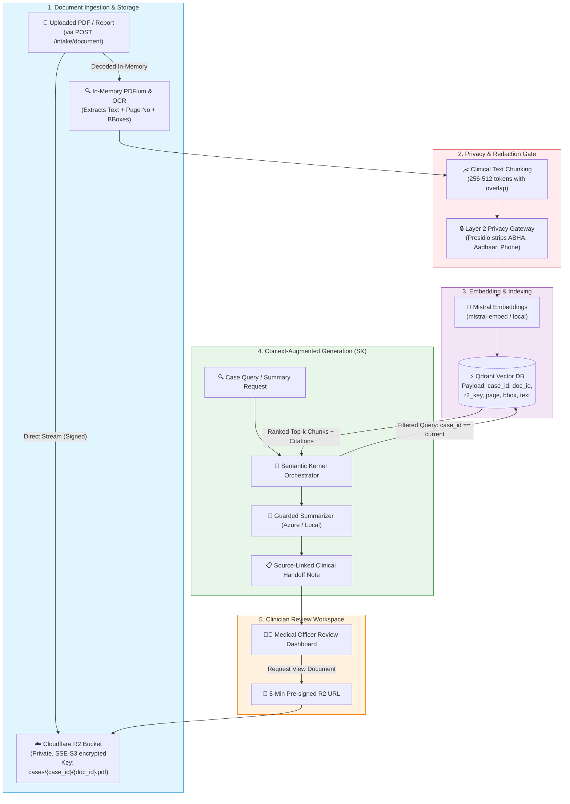
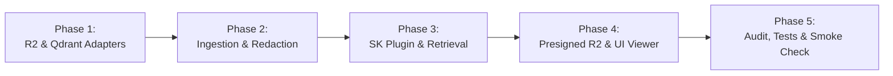

# SEHAT AI — Architecture & Implementation Plan: Cloudflare R2, Mistral Embeddings & Qdrant RAG

> **Document:** `docs/19_Qdrant_R2_RAG_Pipeline.md`  
> **Status:** Architecture Specification & Implementation Roadmap  
> **Target Subsystem:** Document Storage, Clinical Semantic Retrieval & Grounded Evidence Linking  
> **Compatibility:** Non-breaking modular extension of Microsoft Semantic Kernel & SEHAT AI 6-Layer Architecture  

---

## 1. Executive Summary & Design Invariants

This document outlines the architecture, data pipeline, and zero-conflict implementation plan for integrating:
1. **Cloudflare R2** for cost-efficient, zero-egress, encrypted patient PDF & lab report storage.
2. **Mistral Embeddings** (`mistral-embed` or local quantized embedding model) for semantic clinical text vectorization.
3. **Qdrant Vector Database** for sub-millisecond, payload-filtered vector retrieval.

### Non-Negotiable SEHAT AI Architectural Invariants
* **Zero Disruption to Rules-First Triage:** Deterministic AIIMS, NEWS2, and qSOFA rules (`app/rules/`) set triage urgency (`RED`/`YELLOW`/`GREEN`). RAG is strictly an **evidence and historical context enrichment engine**; it can never modify or lower a clinical urgency level.
* **Strict Cross-Patient Data Isolation:** Qdrant similarity searches must **never** run globally across all vectors. Every search query is constrained by a mandatory payload filter: `case_id == active_case_id`.
* **Zero PII to Third-Party Vector Embeddings:** Layer 2 Presidio redaction (`app/privacy/pii.py`) must strip Indian identifiers (Aadhaar, ABHA ID, Indian phone numbers, patient names) before text chunks are embedded.
* **Traceable Source-Linking (Provenance):** Every chunk indexed in Qdrant must retain metadata linking back to its document ID in R2, page number, and OCR bounding box coordinates.
* **Non-Diagnostic & Guarded:** Outputs derived from retrieved context pass through NeMo Guardrails / LLM Output Guards (`app/ai/guard.py`) to block diagnostic claims or prescription advice.

---

## 2. Target Architecture Pipeline



---

## 3. Conflict-Free Integration Strategy

To ensure zero conflicts with existing code:

| Existing SEHAT AI Subsystem | Potential Conflict Risk | Zero-Conflict Architectural Solution |
|:---|:---|:---|
| **`app/routes/ocr.py` & `app/ocr/service.py`** | Upload handling currently processes images/PDFs only in memory or SQLite cache. | Wrap R2 upload in a modular storage adapter (`app/rag/storage.py`). R2 upload occurs asynchronously or during the ingestion task; OCR processing interface remains untouched. |
| **`app/rules/` (AIIMS, NEWS2, qSOFA)** | RAG could inject unvetted clinical diagnoses or alter urgency scoring. | RAG pipeline does **not** feed into Layer 4 urgency calculation. Layer 4 consumes only deterministic vitals and structured symptoms. RAG feeds Layer 5 (handoff note summarization and historical context). |
| **`app/services/kernel.py`** | Semantic Kernel uses Azure Chat Completion. | Add Qdrant via Semantic Kernel's built-in memory store connector (`semantic_kernel.connectors.memory.qdrant`), maintaining the existing `SehatPlugin` without breaking signature changes. |
| **`app/privacy/gateway.py`** | Embedding raw PII could violate DPDP-ready invariants. | Mistral embedding adapter calls `redact_pii()` strictly before serialization. Vectors represent de-identified clinical contexts. |
| **Frontend Evidence Viewer** | Current evidence viewer expects local base64 or temporary blobs. | Backend generates short-lived (e.g. 300-second) S3 pre-signed URLs from R2 for authenticated clinicians (`Role.MEDICAL_OFFICER` or `Role.ANM`). |

---

## 4. Component Details & Data Contracts

### 4.1 Cloudflare R2 Storage Schema

Cloudflare R2 is accessed using the standard AWS S3 client SDK (`boto3` / `aioboto3` in Python).

* **Bucket Configuration:** Private bucket (public access blocked), Server-Side Encryption (AES-256).
* **Object Key Convention:**
  ```text
  facilities/{facility_id}/cases/{case_id}/documents/{document_id}/{filename}.pdf
  ```
* **Lifecycle Rules:**
  * Retention period: Configurable per facility policy (e.g., 30-day cache or permanent retention with access logs).

### 4.2 Qdrant Collection & Payload Schema

* **Collection Name:** `sehat_patient_records`
* **Vector Configuration:**
  * Distance: `Cosine`
  * Dimension: `1024` (matches `mistral-embed`)
* **Payload Structure:**
  ```json
  {
    "case_id": "a1b2c3d4-e5f6-7890-abcd-ef1234567890",
    "facility_id": "dist_hosp_angul_01",
    "document_id": "doc_987654321",
    "r2_key": "facilities/dist_hosp_angul_01/cases/a1b2c3d4/documents/doc_987654321/rx.pdf",
    "page_number": 1,
    "chunk_index": 3,
    "bounding_box": {
      "top": 120.5,
      "left": 45.0,
      "width": 300.0,
      "height": 55.2
    },
    "text_content": "[REDACTED_PATIENT] reported recurrent dry cough for 3 weeks...",
    "source_type": "handwritten_rx",
    "pii_redacted": true,
    "created_at": 1793786400
  }
  ```
* **Indexed Payload Fields:** `case_id` (KeywordIndex), `facility_id` (KeywordIndex), `source_type` (KeywordIndex).

---

## 5. Implementation Roadmap (Phase-by-Phase)



### Phase 1: Environment & Client Adapters
1. **Dependencies:**
   * Add `aioboto3` (async S3 API for Cloudflare R2).
   * Add `qdrant-client`.
   * Add `mistralai` SDK or generic async HTTP client for Mistral embeddings.
2. **Environment Variables:**
   * Add R2, Qdrant, and Mistral settings into `backend/app/config.py` with validation and fallback flags.
3. **Storage Client:**
   * Implement `backend/app/rag/storage.py` (singleton async client for uploading PDFs and generating time-bounded pre-signed read URLs).

### Phase 2: Ingestion, Chunking & Privacy Gate
1. **Chunking & Provenance:**
   * Create `backend/app/rag/chunker.py` to chunk OCR-extracted text paragraphs while preserving line coordinates and page numbers.
2. **Redaction Gate:**
   * Route chunks through `app.privacy.pii.redact_pii` before generating embeddings.
3. **Embedding Service:**
   * Create `backend/app/rag/embeddings.py` supporting:
     * Mode `cloud`: Mistral Embed API (`mistral-embed`).
     * Mode `fake`: Deterministic fixture vectors for test environments without network access.
4. **Qdrant Vector Store Service:**
   * Create `backend/app/rag/vector_store.py` to create collection if missing, create payload indexes (`case_id`), and upsert points.

### Phase 3: Microsoft Semantic Kernel Plugin Integration
1. **RAG Plugin Implementation:**
   * Create `SehatPatientHistoryPlugin` in `backend/app/rag/plugin.py`:
     * Kernel function: `search_patient_history(query: str, case_id: str, limit: int = 4)`
     * Applies hard filter: `models.FieldCondition(key="case_id", match=models.MatchValue(value=case_id))`
2. **Kernel Wiring:**
   * Register the RAG plugin in `backend/app/services/kernel.py` without modifying the core `build_kernel()` signature.
3. **Prompt Template Enrichment:**
   * Update handoff note generation prompts in `backend/app/ai/prompts.py` to accept retrieved history chunks with explicit citations `[Doc: {doc_id}, Page: {page_no}]`.

### Phase 4: Frontend Pre-Signed URL Access & Evidence Viewer
1. **FastAPI Endpoint:**
   * `GET /cases/{case_id}/documents/{doc_id}/view-url`:
     * Authenticated role requirement: `Role.MEDICAL_OFFICER` or `Role.ANM`.
     * Validates that the document belongs to the case.
     * Returns a 5-minute pre-signed R2 URL.
2. **Frontend Viewer Update:**
   * Connect `EvidenceViewer.tsx` to load the high-res PDF directly from R2 using the pre-signed URL when a clinician clicks a citation badge.

### Phase 5: Verification & Safety Tests
1. **Cross-Tenant Leakage Test:**
   * Ensure querying case B with case A's symptoms returns zero results from case A.
2. **PII Redaction Assertion:**
   * Verify that mock documents containing Aadhaar/ABHA strings never appear in Qdrant raw payloads.
3. **R2 Resilience Test:**
   * Test graceful fallback if R2 credentials are unavailable (offline/local mode).

---

## 6. Configuration Reference (`.env`)

```ini
# ==========================================
# Cloudflare R2 Object Storage
# ==========================================
R2_ENABLED=true
R2_ACCOUNT_ID=your_cloudflare_account_id
R2_ACCESS_KEY_ID=your_r2_access_key_id
R2_SECRET_ACCESS_KEY=your_r2_secret_access_key
R2_BUCKET_NAME=sehat-patient-records
R2_ENDPOINT_URL=https://${R2_ACCOUNT_ID}.r2.cloudflarestorage.com
R2_URL_EXPIRY_SECONDS=300

# ==========================================
# Qdrant Vector Database
# ==========================================
QDRANT_ENABLED=true
QDRANT_HOST=localhost
QDRANT_PORT=6333
QDRANT_API_KEY=
QDRANT_COLLECTION=sehat_patient_records

# ==========================================
# Mistral Embedding Model
# ==========================================
MISTRAL_ENABLED=true
MISTRAL_API_KEY=your_mistral_api_key
MISTRAL_EMBED_MODEL=mistral-embed
MISTRAL_EMBED_DIMENSION=1024
```

---

## 7. Summary of Safety & Compliance Guarantees

1. **Non-Diagnostic:** The RAG system retrieves past records for context; it does not output clinical diagnoses or drug recommendations.
2. **DPDP-Ready by Design:** Patient identifiable information is stripped at Layer 2 before vectorization. Unsigned public bucket access is physically disabled.
3. **Clinician Authority:** The Medical Officer sees the exact R2 PDF page citation side-by-side with the AI summary before signing off.
4. **Deterministic Urgency Untouched:** The triage score (`RED`/`YELLOW`/`GREEN`) remains 100% computed by verified AIIMS clinical protocols, completely independent of vector retrieval distances.

