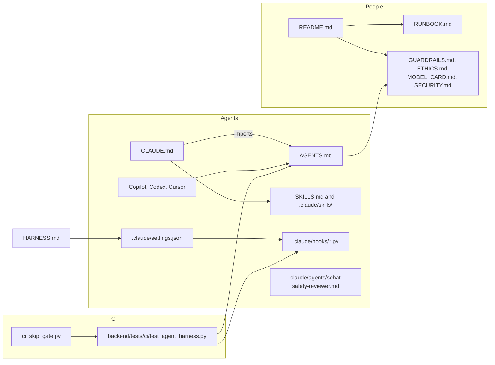

# 20. Agent harness and governance files

> **What this is:** a guide to the governance and agent files at the root of the repository and in `.claude/`: what
> each one contains, who reads it, why it exists and when to update it. Added in Phase 1 (governance and harness).

## Why these files exist

SEHAT AI is medical-safety software, and much of it is written with AI coding agents. Three groups need the same
rules, written down once:

- **People** (the owner, teammates, judges, reviewers) need to know what the product does, what it does not do, how it
  is kept safe and how to run it.
- **Coding agents** (Claude Code, GitHub Copilot, Codex, Cursor) need the same rules in a form they load automatically,
  plus checks that stop them when they drift.
- **CI** needs tests that fail when either group breaks a rule.

## How the files fit together

## The files

| File | What it contains | Who reads it | Why it exists | Update it when |
|:---|:---|:---|:---|:---|
| `README.md` | What SEHAT AI is, the principles, quick start, links to every doc, the disclaimer | Everyone first | The front door | The product's description, setup or doc set changes |
| `AGENTS.md` | Project overview, the docs table, **Agent Rules 1–8** (unchanged), governance file list, repository map, commands, CI gates, safety invariants with their code and tests, git and data rules, protected files, the work-in-progress no-go list, definition of done | Every coding agent at session start; new teammates | One rule book for every agent; `AGENTS.md` is the cross-agent convention | A rule, invariant, command, protected path or WIP path changes. The eight rules change only with the owner's decision |
| `CLAUDE.md` | `@AGENTS.md` (imports it), then the Claude Code workflow: start in the repo root, one worktree per phase, stop after each phase, commit on "commit this", the venv and port facts, the skills and subagent table | Claude Code, automatically | Claude Code reads `CLAUDE.md`, not `AGENTS.md`; the import keeps one source of rules | The Claude-specific workflow changes |
| `SKILLS.md` | Index of project skills: when each applies and what it gives; how to add a skill | People and agents | Skills load on demand; the index shows what exists | A skill is added, renamed or removed (the harness tests enforce this) |
| `.claude/skills/*/SKILL.md` | Five task playbooks: `sehat-safety-change`, `sehat-run-tests`, `sehat-real-app-check`, `sehat-demo-run`, `sehat-evidence-corpus` | Claude Code when a task matches the description | Repeatable, correct procedures for the risky or fiddly tasks | The procedure or its commands change |
| `.claude/agents/sehat-safety-reviewer.md` | A review-only subagent (no edit tools) with an 11-point safety checklist; reports `PASS` or `BLOCK` with file:line | Claude Code, when asked to review | A second pair of eyes on every safety change, using the same rules | The safety rules or invariants change |
| `.claude/settings.json` | Permission deny rules (`.env`, `sehat.db`, worst git and `sudo` commands) and the two hook registrations | Claude Code | Enforcement that does not depend on the agent remembering the rules | A rule needs tool-level enforcement (keep it in step with the hooks) |
| `.claude/hooks/sehat_policy.py`, `bash_guard.py`, `edit_guard.py` | The decision rules (deny or ask) for shell commands and file edits, and the hook entry points | Claude Code before every Bash, Edit or Write call | Stops broad git operations, secrets, the shared database and unapproved safety changes | A protected path, WIP path or command rule changes (add a test case too) |
| `HARNESS.md` | What the harness is, why Claude Code native and not HarnessKit, the layers, the hook decision table, how to use, test and change it, its limits, the planned safety-evaluation harness | People maintaining the harness | Explains and bounds the enforcement | Any `.claude/` change |
| `GUARDRAILS.md` | Every safety control: what it does, code, test, failure mode, limits, status (built, partial, planned); the planned list; known limits | Judges, reviewers, clinicians, agents | Honest, checkable evidence of how SEHAT stays safe, and what is not built | Any control is added, changed or removed |
| `ETHICS.md` | Position (does / does not), principles mapped to code, Indian law and guidance, international references, patient rights today, the go/no-go list before real patients, what we never claim | Judges, ethics reviewers, partners | Medical AI must show how it respects patients and law; marked "not legal advice" | A law's status changes, a right is implemented, or a claim changes |
| `MODEL_CARD.md` | Intended use, every model and engine with pin and licence, measured results with denominators, what is not measured, failure modes and mitigations | Judges, reviewers, anyone choosing a model | Feature #32; makes model limits visible | A model, pin or measurement changes |
| `SECURITY.md` | How to report a vulnerability privately, scope, controls in place, known limits, what to do if a secret leaks | Security researchers, teammates | A clear, private reporting route and an honest security posture | A control, limit or reporting route changes |
| `RUNBOOK.md` | Prerequisites, setup, running the app, the local model, tests and CI, evaluations, demo, troubleshooting, the test baseline, the roadmap | Teammates, the person running the demo | Lets anyone set up, run and check the project without asking | Commands, ports, baselines or phases change |
| `Makefile` | Shortcuts: `doctor`, `setup`, `test`, `ci`, `hooks-test`, `safety-test`, `safety-eval`, `safety-eval-quick`, `eval-summary`, `llm-*`, `dev-backend`, `dev-frontend`, `demo`, `demo-seed`, `demo-check` | People and agents | One command per common task; every target calls an existing script | A script or command it wraps changes |
| `backend/scripts/doctor.py` | Read-only environment check (Python, venv, packages, Node, model file, SQLite FTS5, ports, disk, branch) | People before a run or a demo | Finds setup problems before they appear on stage | A new prerequisite appears |
| `.github/pull_request_template.md` | "How it was checked" and the 11-line safety checklist | Every pull request author and reviewer | Puts the Agent Rules in front of every change | A rule or check changes |
| `backend/tests/ci/test_agent_harness.py` | 129 tests: hook decisions, settings wiring, skill names, the reviewer's tools, the eight Agent Rules, the `CLAUDE.md` import | CI (a required module in the skip gate) | A harness edit that stops blocking fails the build | The hooks or rules change |

## Which file to open when

| You want to… | Open |
|:---|:---|
| Run the project or the demo | `RUNBOOK.md`, then `make help` |
| Know what an agent may and may not do | `AGENTS.md` (rules), `HARNESS.md` (enforcement) |
| Change urgency rules, consent, privacy or a model | The `sehat-safety-change` skill, `GUARDRAILS.md` |
| Answer a judge on safety, ethics or models | `GUARDRAILS.md`, `ETHICS.md`, `MODEL_CARD.md` |
| Report a vulnerability | `SECURITY.md` |
| Understand the product and architecture | `docs/01`–`docs/19`, and `docs/sehat_ai_final_architecture__2.md` |
