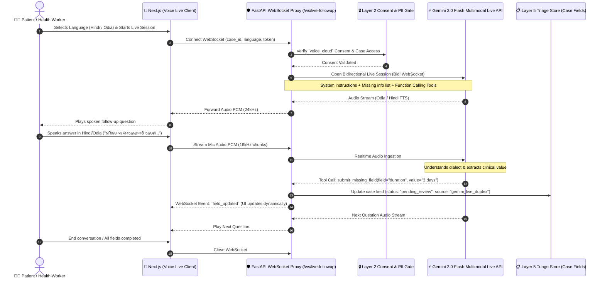
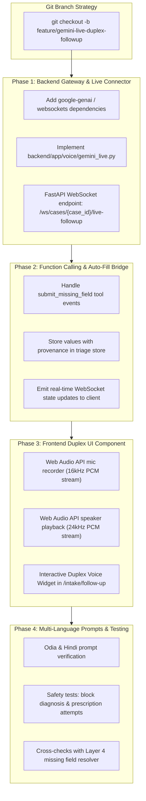

# SEHAT AI — Architecture & Implementation Plan: Gemini 2.0 Flash Multimodal Live (Duplex Voice Follow-up)

> **Document:** `docs/20_Gemini_Live_Duplex_Voice_Followup.md`  
> **Status:** Architecture Specification & Implementation Roadmap  
> **Target Subsystem:** Layer 5 Conversational Missing Information Gathering (Duplex Voice in Hindi & Odia)  
> **Git Target Branch:** `feature/gemini-live-duplex-followup` (Isolated from `main`)  
> **Core Principle:** Non-diagnostic, rules-governed intake. Voice pre-fills fields; a human clinician always reviews and confirms.  

---

## 1. Executive Summary & Problem Statement

Currently, when required vitals or clinical details are missing after initial multimodal intake, the system identifies the missing gaps at **Layer 4** ([`app/rules/required_fields.py`](backend/app/rules/required_fields.py)) and generates static follow-up questions at **Layer 5** ([`app/ai/followup.py`](backend/app/ai/followup.py)). Health workers or patients currently have to manually type or click through these follow-ups.

### The Solution: Duplex Conversational Voice Follow-Up
Integrating **Google Gemini 2.0 Flash (Multimodal Live API)** enables real-time, low-latency, bidirectional spoken conversation (Duplex):
1. The assistant dynamically speaks follow-up questions to the patient in **Hindi** or **Odia**.
2. The patient speaks naturally in reply.
3. The model processes the patient's voice response in real time, uses **Live Function Calling** (`submit_missing_field`) to extract the exact clinical value, and automatically populates the triage form.
4. The extracted fields are tagged with complete provenance (`source="gemini_live_duplex"`, language, audio timestamp/transcript snippet, and status `pending_review`).

---

## 2. Architecture & Data Flow



---

## 3. Strict Safety & Regulatory Guardrails

In compliance with **SEHAT AI Core Invariants**:

1. **Explicitly Non-Diagnostic (TPG 5.4 / ICMR 2023):**
   * The Gemini 2.0 Live system prompt forbids giving medical diagnoses, prognoses, reassurance ("you will be fine"), or prescribing medications.
   * If the patient asks for medical advice ("What medicine should I take?"), the model is hard-prompted to respond:
     * *Hindi:* "मैं कोई दवा या निदान नहीं बता सकता। डॉक्टर साहब इसकी जांच करेंगे।"
     * *Odia:* "ମୁଁ କୌଣସି ଔଷଧ କିମ୍ବା ରୋଗ ନିର୍ଣ୍ଣୟ ଦେଇପାରିବି ନାହିଁ। ଡାକ୍ତର ବାବୁ ଏହା ଯାଞ୍ଚ କରିବେ।"
2. **Consent & DPDP-Ready Boundary:**
   * Requires explicit `voice_cloud` consent scope before initiating the WebSocket session.
   * No patient PII (names, Aadhaar, ABHA, phone numbers) is passed to the Gemini session initialization context. The session only receives:
     * Target language (`hi-IN` or `or-IN`)
     * List of missing fields and clinical questions (e.g. `["fever_duration", "cough_severity"]`).
3. **Mandatory Human-in-the-Loop Sign-off:**
   * Values filled by the Duplex voice model are tagged with `status: "pending_review"`.
   * The reviewing Medical Officer/ANM sees the voice badge and the transcript snippet and must confirm or edit the value before final sign-off.
4. **Urgency Setting Rule:**
   * Spoken inputs pre-fill fields, but **only Layer 4 deterministic rules** set the triage urgency. The voice model never sets urgency.

---

## 4. Live Tool Calling (Function Definition)

Gemini 2.0 Live will be equipped with two client-side tools:

### `submit_missing_field`
Called automatically by Gemini whenever the patient states a missing piece of information.
```json
{
  "name": "submit_missing_field",
  "description": "Submits an extracted medical measurement or symptom detail provided by the patient.",
  "parameters": {
    "type": "OBJECT",
    "properties": {
      "field_name": {
        "type": "STRING",
        "description": "Standardized field name, e.g., 'spo2', 'pulse', 'bp_systolic', 'bp_diastolic', 'duration', 'fever_temperature'"
      },
      "value": {
        "type": "STRING",
        "description": "The normalized value extracted from patient speech (e.g. '98', '3 days', 'mild')"
      },
      "unit": {
        "type": "STRING",
        "description": "Optional unit, e.g., '%', 'bpm', 'days', 'deg F'"
      },
      "patient_raw_phrase": {
        "type": "STRING",
        "description": "The exact vernacular phrase spoken by the patient"
      }
    },
    "required": ["field_name", "value", "patient_raw_phrase"]
  }
}
```

### `finish_intake`
Called when all missing questions have been addressed or the patient signals they want to stop.
```json
{
  "name": "finish_intake",
  "description": "Concludes the missing information gathering session.",
  "parameters": {
    "type": "OBJECT",
    "properties": {
      "reason": {
        "type": "STRING",
        "enum": ["all_fields_collected", "patient_requested_stop", "clinical_red_flag_interruption"]
      }
    },
    "required": ["reason"]
  }
}
```

---

## 5. Phased Implementation Plan



### Detailed Phase Breakdown

#### Phase 1: Backend WebSocket Proxy & Gemini Live Client
* **File:** `backend/app/voice/gemini_live.py`
* **Features:**
  * Connect to Google Gemini Multimodal Live API over WebSocket (`wss://generativelanguage.googleapis.com/...`).
  * Support model `gemini-2.0-flash-exp` (or `gemini-2.0-flash`).
  * Configure audio format: Input 16kHz PCM, Output 24kHz PCM.
  * Inject language-specific system prompts (Hindi / Odia).
* **Endpoint:** `backend/app/routes/voice.py`
  * Add `@router.websocket("/cases/{case_id}/live-followup")`.
  * Validate bearer token and `voice_cloud` consent check before proxying audio bytes.

#### Phase 2: Function Calling & Auto-Fill Bridge
* When Gemini triggers `submit_missing_field`:
  * Map `field_name` to SEHAT AI canonical schema ([`app/rules/required_fields.py`](backend/app/rules/required_fields.py)).
  * Create evidence entry:
    ```json
    {
      "field": "duration",
      "value": "3 days",
      "source": "gemini_live_duplex",
      "language": "or",
      "raw_speech": "ମୋତେ ୩ ଦିନ ହେଲା କାଶ ହେଉଛି",
      "review": {"outcome": "pending", "reviewer": null}
    }
    ```
  * Push WebSocket event `{ "event": "field_filled", "field": "duration", "value": "3 days" }` to the frontend.

#### Phase 3: Frontend Duplex Voice Widget
* **File:** `frontend/src/components/DuplexVoiceFollowUp.tsx`
* **Features:**
  * Animated voice waveform / duplex orb indicator (Speaking vs Listening vs Processing).
  * Audio worklet / ScriptProcessor streaming mic audio chunks to backend WebSocket.
  * Real-time audio buffer playback for incoming Gemini voice.
  * Live field auto-fill animation showing fields populating on-screen as the patient speaks.
  * Language toggle (`हिन्दी` / `ଓଡ଼ିଆ`).

#### Phase 4: Verification & Test Matrix
* **Unit Tests:**
  * `test_gemini_live_tool_call_mapping.py`: Validates that tool arguments properly map to canonical required fields.
  * `test_gemini_live_safety_prompts.py`: Verifies that mock responses containing "you have pneumonia" or "take paracetamol" are filtered by output guards.
  * `test_consent_gate.py`: Rejection of live connection if `voice_cloud` consent is missing.

---

## 6. Git Branch & Delivery Strategy

As requested, all code changes will be developed exclusively on a dedicated feature branch:

```bash
# 1. Ensure main is clean
git checkout main
git pull origin main

# 2. Create feature branch
git checkout -b feature/gemini-live-duplex-followup

# 3. Work on implementation phases 1 through 4

# 4. Verify test suite passes without affecting main
pytest backend/tests/
```

This guarantees **zero regressions** on `main` until the duplex feature is verified and reviewed.

